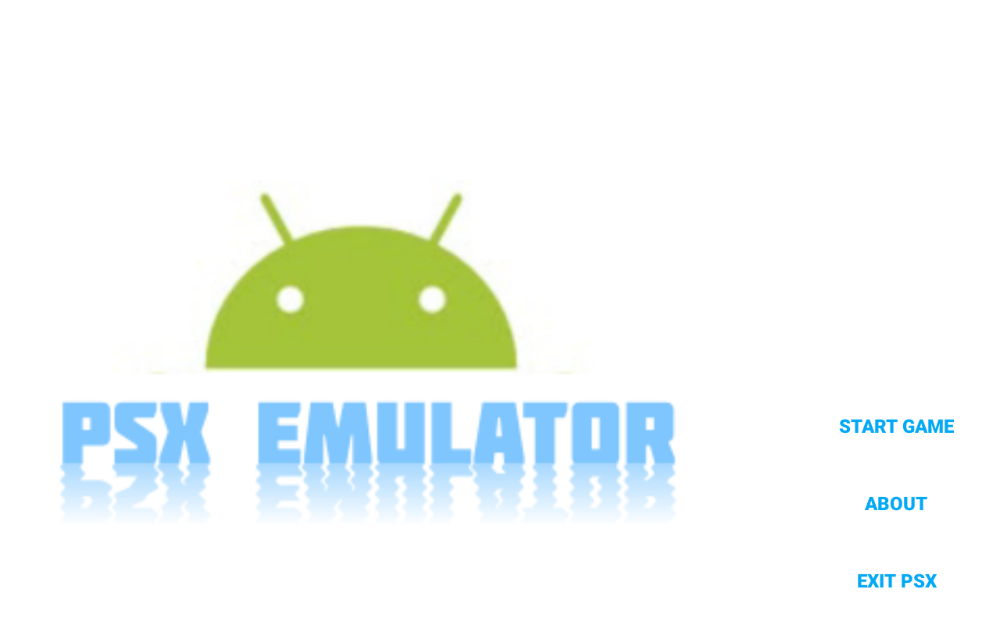
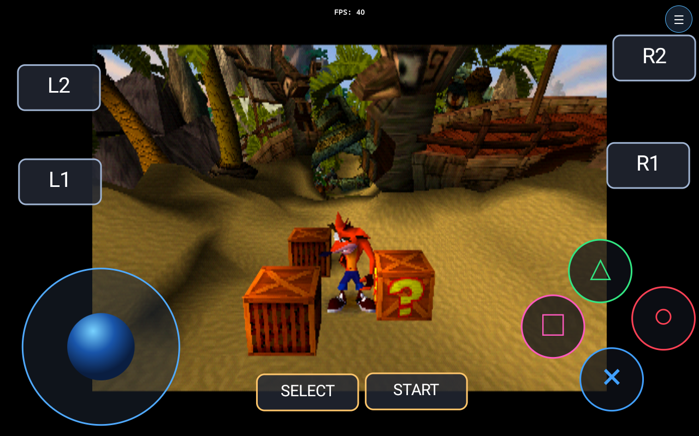
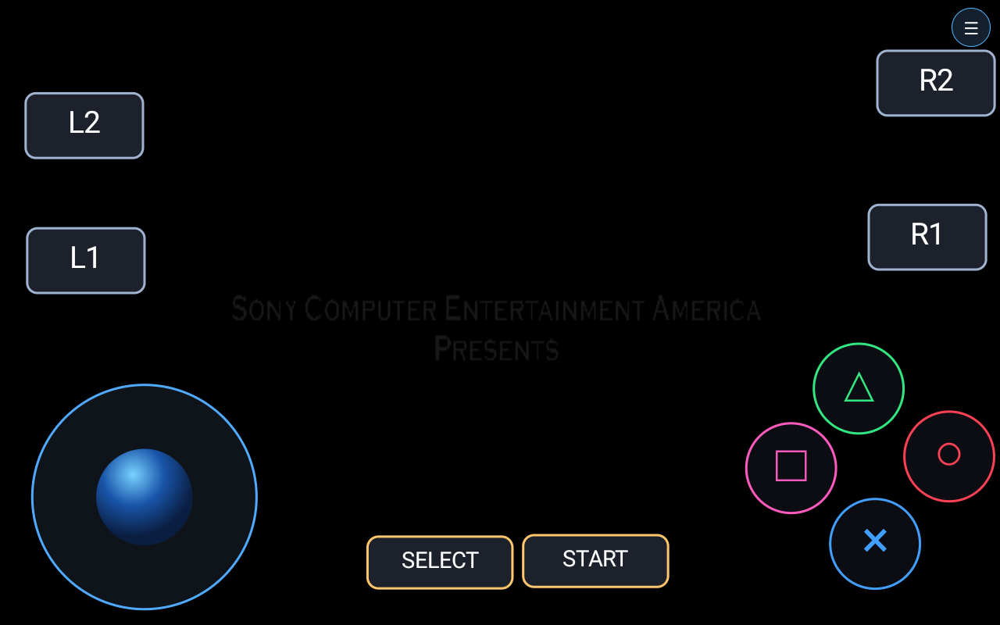

# Yes7user PSX Emulator

A lightweight PlayStation 1 emulator for Android, powered by **PCSX-ReARMed** and a custom Android JNI bridge.

**Current release:** `v1.0.1`  
**Developer:** Yes7user  
**Platform:** Android

---

## Features

- Play PlayStation 1 games on Android.
- Powered by the PCSX-ReARMed Libretro core.
- On-screen virtual controls with multitouch support.
- Customizable on-screen control layout.
- Adjustable virtual controller transparency.
- Fullscreen gameplay.
- Landscape gameplay.
- Settings screen for emulator options.
- FPS counter.
- Save states and load states.
- Separate save-state files for individual games.
- Support for `.chd` and `.cue/.bin` game images.
- Optimizations intended to improve playability on lower-end Android devices.

## What's new in 1.0.1

- Added a Settings screen.
- Added a fullscreen option.
- Added an option to adjust the transparency of the on-screen controls.
- Updated player input: Player 1 uses the phone's touchscreen controls, while Player 2 uses an external game controller.
- Fixed the BIOS save issue.
- Reduced the available cheats to the first six entries.

## Screenshots

### Home Screen



### Gameplay



### On-screen Controls



## Requirements

- Android 5.0 or later.
- ARMv7 device (`armeabi-v7a`, `ARM64`).
- At least 2 GB RAM recommended.

> The repository currently includes the `armeabi-v7a, ARM64` native library build.

## Installation

1. Download the APK from the [Releases](https://github.com/4NDROID-arch/PSX_EMULATOR/releases) page.
2. Install the APK on your Android device.
3. Open the emulator and set up your game and BIOS files when prompted.
4. Select a supported game image to start playing.

## Game and BIOS files

This project does not provide PlayStation BIOS files or commercial game images.

Use only BIOS and game files that you are legally entitled to use. Place or select your files using the emulator's file picker and the storage locations configured by the app.

### Supported game formats

- `.chd`
- `.cue`
- `.bin` — use with its matching `.cue` file.
- `.iso`
- `.exe`

Make sure each CUE file references the correct BIN filename.

## Controls

- **Player 1:** On-screen touchscreen controls.
- **Player 2:** External physical game controller.

The on-screen controls support multitouch. Their transparency can be adjusted in the available control settings.

## Save States

The emulator supports saving and loading game states. Save states are kept separately for each game so that one game's state does not overwrite another game's state.

Keep backup copies of important save data before reinstalling the app or changing builds.

## Native Libraries and Technology

The project uses:

- PCSX-ReARMed Libretro core.
- Custom JNI bridge.
- Android NDK native libraries.

### Included ABI

- `armeabi-v7a`
- `ARM64`

### Native project structure

```text
jni/
├── psxbridge.c
├── libretro.h
├── Android.mk
└── Application.mk

app/src/main/jniLibs/armeabi-v7a/
├── libpcsx_rearmed_libretro_android.so
└── libpsxbridge.so
```

## Project Repository

[4NDROID-arch/PSX_EMULATOR](https://github.com/4NDROID-arch/PSX_EMULATOR)

## Disclaimer

Yes7user PSX Emulator is an independent community project and is not affiliated with, endorsed by, or sponsored by Sony Interactive Entertainment.

PlayStation is a trademark of Sony Interactive Entertainment.

This repository does not include copyrighted PlayStation BIOS files or commercial game files. Users are responsible for supplying files they are legally permitted to use.

---

**Developed by Yes7user**
